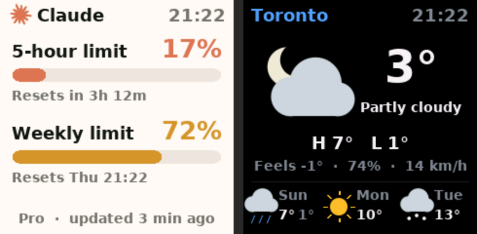
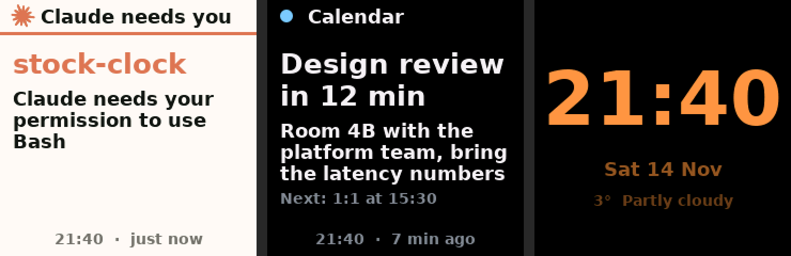

# sdc2-stock-clock

Custom ESP-IDF firmware for the **JUZIPi SDC2 "Smart Weather Clock"** (ESP32-C2, 240x240 ST7789 IPS).
It turns the clock into a desk ticker that shows:

- **Markets:** an overview of up to 10 stocks, indexes, forex pairs or crypto, then one page per symbol with price,
  daily change and an intraday chart (Yahoo Finance, no API key)
- **Weather:** current conditions with a drawn icon, high/low, feels-like, humidity, wind and a 3-day forecast
  (Open-Meteo, no API key)
- **Claude usage:** your Claude plan's 5-hour and weekly limits, pushed from your Mac
- **Push pages:** anything another device sends it, e.g. "Claude needs you" from Claude Code hooks
- **Night mode:** dims and shows a big clock during the night hours
- **Alerts:** jumps to a symbol that moves more than ±X%, or to the Claude page when a limit gets high

Everything is set up from the clock's own web page; it is updated over Wi-Fi only (the SDC2 has no USB data).

| Claude usage / weather | Push page / dark push page / night clock |
|---|---|
|  |  |

> Not affiliated with JUZIPi or Anthropic. Yahoo's chart endpoint and Anthropic's usage endpoint are unofficial and
> may change. Flashing custom firmware is at your own risk, though the safety net below makes it hard to brick.

## Install

1. Open the clock's original web page and go to **Firmware Update (OTA)**.
2. Upload `dist/SDC2_stocks_v1.0.11.bin`. The original updater only accepts file names starting with `SDC2`.
3. The clock reboots into Stock Clock and joins the same Wi-Fi. Its address is shown on screen.
4. Open `http://<clock-ip>/` to set symbols, time zone, weather location and the rest.

The original firmware stays in the other app slot, so you can go back from the Firmware section at any time.

## Safety net

The clock has no USB data connection, so the firmware protects itself:
- The original firmware stays in the other app slot (`app0`) until you upload a custom build through
  *this* firmware's updater. To keep it, switch to the original first and upload through *its* updater.
- A boot counts as failed if the clock restarts before it has been on Wi-Fi for 30 s with its web page answering.
  - A build that has never worked: after 3 failed boots it tries the last working settings, and after 5 it goes back to the original.
  - A build that has worked before: 3 failed boots restore the last working settings (or defaults), 6 reset to defaults, and 10 go back to the original.
- If its own web page stops answering for about 90 s, the clock restarts itself, which counts as a failed boot.
- **Manual escape hatch:** start it 10 times in a row, unplugging each time as soon as text appears on the screen.
  The 10th start boots the original firmware.
- On a new build's first run, if it never reaches Wi-Fi within 10 minutes (longer while someone uses the
  `StockClock-XXXX` setup network), it switches back to the original firmware.
- Without stored Wi-Fi credentials it opens an open `StockClock-XXXX` access point; join it and browse to http://192.168.4.1.
- The settings page shows the last restart reasons (`PWR`, `SW`, `PANIC`, `TASKWDT`, ...) and any recovery it did.

The web page has no password: anyone on your network can change settings or upload firmware.

## Push pages

Any device on your network can put a page on the clock:

```bash
curl http://<clock-ip>/api/push -d id=build -d title="CI" -d l1="main is green" -d l2="all 214 tests passed" -d ttl=1800
curl http://<clock-ip>/api/push -d id=build -d clear=1
```

| Field | Meaning |
|---|---|
| `id` | slot name (required); posting the same id replaces the page. Up to 4 pages. |
| `title` | header text |
| `l1`, `l2`, `l3` | big line, normal line, small dim line (word-wrapped; ASCII only) |
| `color` | accent colour, `RRGGBB` |
| `theme` | `dark` (default) or `claude` (ivory with the spark logo) |
| `alert` | `1` = jump to it now, then show it every other page (also at night) until cleared or expired |
| `ttl` | seconds until it disappears (default 3600, max 7 days) |
| `clear` | `1` = remove the page |

Active pages are listed under Messages on the settings page, where you can clear them.
While a message is newer than 10 minutes (configurable there, or off), a dot in its colour shows next to the clock
on the other pages, with a count when there are several.

### "Claude needs you" (Claude Code hooks)

`tools/clock_hook.py` turns Claude Code hook events into push pages:
- **Notification** (Claude is waiting for permission or input): "Claude needs you", with the project and message
- **Stop** (Claude finished its turn): "Claude is done"
- **UserPromptSubmit / PostToolUse / SessionEnd:** clears that session's page

To install, copy the scripts to their permanent place (the templates expect this folder):

```bash
mkdir -p ~/Library/Application\ Support/StockClock
cp tools/clock_hook.py tools/claude_usage_push.py ~/Library/Application\ Support/StockClock/
```

Then add the `hooks` block from [`templates/claude-hooks.json`](templates/claude-hooks.json) to
`~/.claude/settings.json`, replacing `CLOCK_IP` with your clock's address. If you already have hooks, append these
entries to your existing event lists instead of replacing them. New Claude Code sessions pick them up.
The `PostToolUse` guard skips starting Python on every tool call unless a page is actually showing.

## Claude usage page

`tools/claude_usage_push.py <clock-ip>` reads the Claude Code login from the macOS keychain, asks Anthropic's
(undocumented) usage endpoint for the same numbers as Claude Code's usage view, and sends only the percentages and
reset times to the clock (`POST /api/claude` with `s`, `sr`, `w`, `wr`, `plan`). The login token only goes to
api.anthropic.com. Bars turn amber at 70% and red at 90%. The page hides itself after 24 hours without an update.

To run it every 5 minutes, install the LaunchAgent from
[`templates/com.stockclock.claude-usage.plist`](templates/com.stockclock.claude-usage.plist) (after copying the scripts as
above; replace the IP):

```bash
sed -e "s|HOME_DIR|$HOME|g" -e "s|CLOCK_IP|192.168.1.50|g" templates/com.stockclock.claude-usage.plist \
  > ~/Library/LaunchAgents/com.stockclock.claude-usage.plist
launchctl bootstrap gui/$(id -u) ~/Library/LaunchAgents/com.stockclock.claude-usage.plist
```

It logs to `~/Library/Application Support/StockClock/push.log`.
Remove it with `launchctl bootout gui/$(id -u)/com.stockclock.claude-usage` and delete the plist.

## Night mode and alerts

- **Night mode** (default 22:00–08:00): the screen dims (default 10%, or off) and shows a big clock with the date
  and temperature, or keeps the normal pages if you prefer. Alert push pages still show.
- **Price alerts:** when a symbol's daily change crosses ±X% (default 3%), the screen jumps to it and holds it for
  three page times. It fires once per direction and re-arms when the move falls back below half the threshold or on a
  new trading day.
- **Claude limit alert:** jumps to the Claude page when the 5-hour or weekly limit reaches the set level (default 90%).
- Nothing fires for conditions that were already true when the clock started.
- The firmware also drives GPIO7 as a piezo buzzer (volume and Test buttons on the page), but the unit tested here
  has no buzzer fitted.

## Building

Needs ESP-IDF **v5.5.1** (matches the stock bootloader; ESP32-C2 rev 1.0–2.99, 26 MHz crystal, 4 MB DIO flash).

```bash
idf.py set-target esp32c2
idf.py build
curl --data-binary @build/stock_clock.bin http://<clock-ip>/ota
```

The clock's app slots are fixed by its original partition table; a `.bin` must stay under about 782,000 bytes
(v1.0.11 is about 690 KB). To fit, `sdkconfig.defaults` turns off unused Wi-Fi and TLS features, uses the C2's ROM
mbedTLS, and drops all logging, panic printing and the serial console (nobody can read the serial port anyway).
Keep `CONFIG_LWIP_NETIF_LOOPBACK=y`: the web server's control socket needs it, and without it the web page is dead.
`partitions.csv` is only for the build's size check; OTA never changes the clock's partition table.

Fonts are generated from DejaVu Sans Bold: `python tools/gen_fonts.py main/fonts.c` (needs Pillow and matplotlib).

## Hardware (JUZIPi SDC2, read from its stock firmware)

| Signal | GPIO |
|---|---|
| SPI SCLK | 1 |
| SPI MOSI | 2 |
| DC | 0 |
| RST | 3 |
| CS | tied to GND |
| Backlight (PWM, active low) | 5 |
| GPIO18 | input with pull-up in the original firmware; no visible button |
| GPIO7 | PWM in the original firmware; no buzzer fitted on the tested unit |

Display: ST7789, SPI mode 3, colour inversion on, RGB order (checked against photos of the screen). Flash: 4 MB; partitions nvs 0x9000, otadata 0xE000,
app0 0x10000 and app1 0xD0000 (0xC0000 each), spiffs 0x190000 (2.5 MB, used by the original firmware).

The GeekMagic ESP32-C2 clock uses different pins (SCLK 4, MOSI 6, DC 5, RST 1, backlight 18); they can be changed
under Display wiring on the settings page.

## Backups

This repository doesn't include any JUZIPi firmware. Before experimenting, keep a copy of your clock's original
app: it stays in `app0` as long as you upload custom builds through the original firmware's updater.
